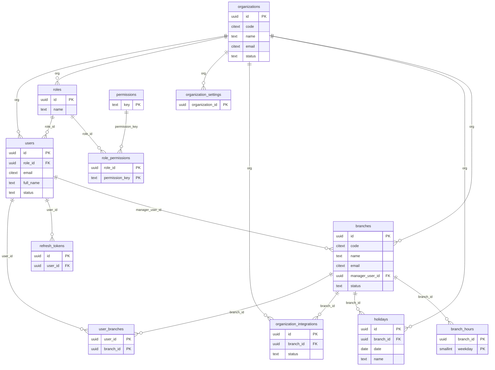
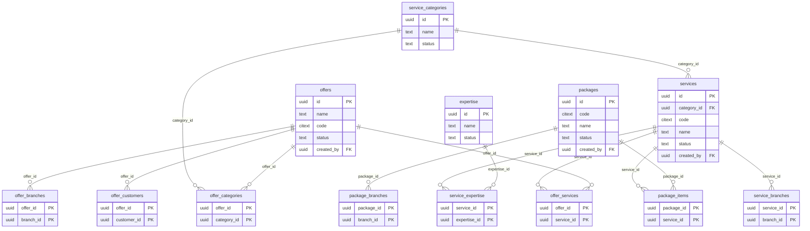
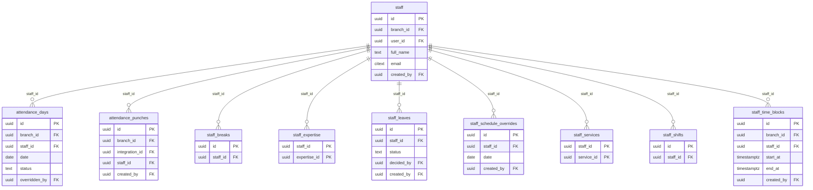
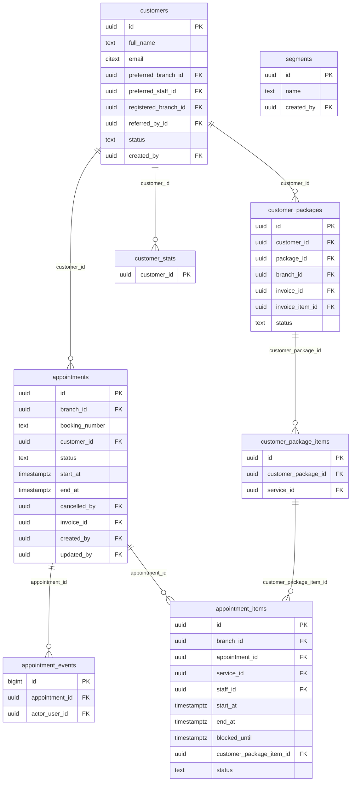
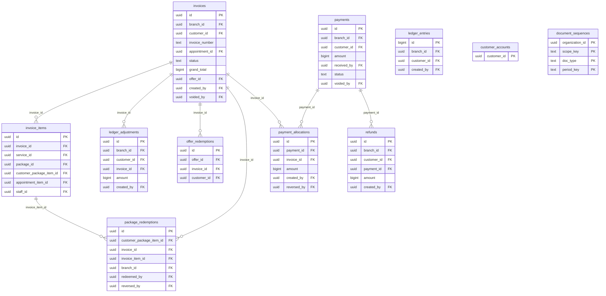
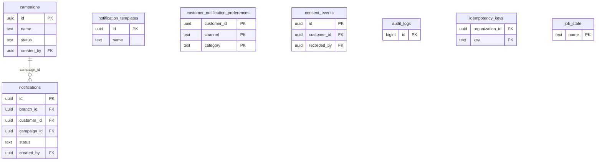

# Entity-relationship diagrams

Generated from the live schema by `npm run db:erd -w @salon/api` (62 tables, 8 migrations applied). Do not edit by hand:
re-run the script after adding a migration. Only key columns are shown; the SQL migrations in
`apps/api/src/db/migrations` are the full definition.

Conventions that hold for every table below:

* UUID primary keys; `timestamptz` for every instant; money in integer minor units (paise); statuses are text with CHECK constraints.
* Tenant-owned tables have `organization_id` and **row-level security** (59 tables). The runtime database role is not the table owner, so
  the policies always apply; migrations run as a separate owner role.
* Foreign keys to tenant-owned tables are composite `(organization_id, id)`, so a row can never point at another tenant's data.

## Tenancy, users and access control

Every tenant-owned table carries `organization_id`; branch-scoped data also carries `branch_id`. Users reach branches through `user_branches` and permissions through their role.

## Services, packages and offers

The catalogue. Services belong to a category, require expertise and are priced per branch when needed. Packages bundle services; offers discount bills.

## Staff, schedules and attendance

Availability (shifts, breaks, leave, blocked time) is separate from attendance (what actually happened, from punches).

## Customers and appointments

`appointment_items` holds one row per service; an exclusion constraint on (staff, time range) makes double-booking impossible at the database level.

## Billing, payments and the ledger

Invoices and payments are immutable once issued. `ledger_entries` is append-only and `customer_accounts` is maintained by a trigger, so balances are always derivable from the ledger.

## Notifications, consent and platform tables

`notifications` is a transactional outbox: rows are written in the same transaction as the business change and delivered by the worker.

## Where each rule is enforced

| Rule | Enforced by |
| --- | --- |
| No double-booking of a team member | exclusion constraint `appointment_items_no_staff_overlap` (gist on staff + time range) plus a per-staff advisory lock in the service layer |
| Tenant isolation | row-level security policies on `app.org_id`; composite foreign keys `(organization_id, id)` |
| Ledger and audit trail can never be edited or deleted | the runtime role has no UPDATE or DELETE on `ledger_entries`, `audit_logs`, `appointment_events`, `invoice_items`, `refunds`, `ledger_adjustments`, and no DELETE on `invoices`, `payments`, `payment_allocations` |
| Customer balance equals the sum of their ledger | `customer_accounts` is written only by a security-definer trigger on `ledger_entries`; `GET /ledger/reconcile` and the restore script verify it |
| Invoice and payment totals add up | deferred constraint triggers verify settlement at commit |
| Gapless invoice / receipt / booking numbers | `document_sequences` row locked inside the issuing transaction |
| A request is never processed twice | `idempotency_keys` unique per organization and key |
